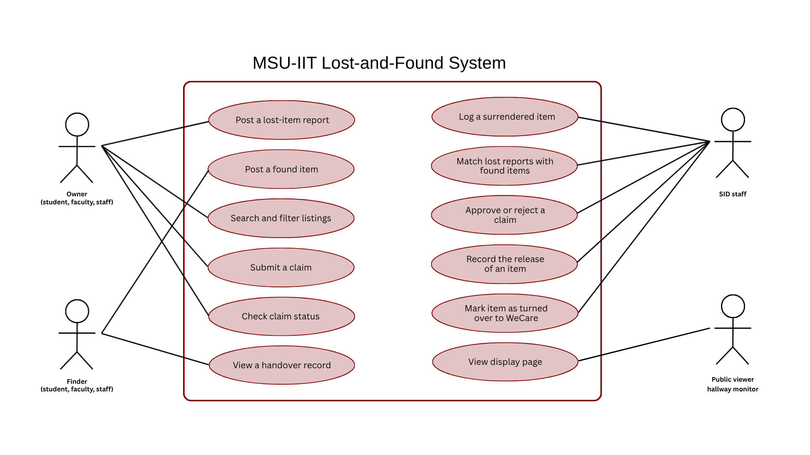

# Product Backlog

## Team Information

- Team name: Anti-Kamote Gang
- Project title: MyFinder
- Primary user group for the first release: MSU-IIT constituents who lost an item
- Format: User stories with one use case

| Member | GitHub username | Personal CSC181 repository |
|---|---|---|
| Kate Mikaela R. Dagohoy | mxikai | https://github.com/mxikai/csc181 |
| Joash S. Casiño | joashcasino-sketch | https://github.com/joashcasino-sketch/csc181 |
| Kythe Florence P. Fontilla | kythe-fontilla | https://github.com/kythe-fontilla/CSC181 |
| Kenneth Jerome C. Gloria | Kenji7676 | https://github.com/Kenji7676/csc181 |

## 1. Interview Summary

| Code | Stakeholder role | Date | Method | Interviewer(s) |
|---|---|---|---|---|
| V1 | Faculty/Staff | 2026-10-21 | In person | Dagohoy |
| V2 | MSU-IIT Student | 2026-10-21 | In person | Casiño |
| V3 | MSU-IIT Student | 2026-10-21 | In person | Casiño |
| V4 | Faculty/Staff (utility worker) | 2026-10-23 | In person | Fontilla |
| V5 | Security Personnel (SID) | 2026-10-23 | In person | Gloria |

## 2. From Interview Notes to Needs

Type is F (functional), Q (quality / non-functional), or C (constraint).

| ID | Source | What we heard or saw | Underlying need | Requirement idea | Type |
|---|---|---|---|---|---|
| F1 | V2, V3 | Students retrace their steps, then post on the CATS group page if the item is not found. | Owners need a dedicated place to report a loss, instead of a general group page where posts get buried. | Let users post a lost-item report with description, place, and date. | F |
| F2 | V2 | Getting an item back takes "at least a day" because the student waits for whoever picked it up to respond. | Owners need to see right away whether their item was found and where it is. | Show found items with a visible status (e.g., with SID / claimed) that owners can check. | F |
| F3 | V2 | Found-item posts often do not say who has the item, and finders are often not responsive. | Owners need to know who holds the item and where to claim it, without chasing the finder. | Every found listing shows who is holding the item and where to claim it. | F |
| F4 | V2, V3 | Students want to see when and where the item was found before claiming. | Owners need enough detail to judge whether a listing is theirs. | Require "date found" and "location found" on every found listing. | F |
| F5 | V3 | A student would use the app if it has a search button where they type the item or a description and results appear. | Owners need to find their item quickly without scrolling through every post. | Search and filter listings by keyword, category, location, and date. | F |
| F6 | V3, V1 | Students are fine with item photos being public, but IDs should be covered. V3 said cover the face and ID number. V1 said cover everything except the name. | Owners and finders need sensitive ID details protected while the item can still be recognized. | Let the poster blur or hide sensitive parts of a photo, and hide sensitive details from public view. | F |
| F7 | V4, V1 | Exact money in a wallet should not be posted. Staff use that amount to verify the claimant. V1 also would not disclose how much money was found. | Details used to verify ownership must stay hidden from the public so claimants cannot just copy them. | Do not show contents or amounts on listings. Ask the claimant to supply them in the claim form instead. | Q |
| F8 | V4 | A wallet found in a comfort room had no money left, and the staff member who found it was accused of stealing. This has happened many times. | Finders need proof of when and in what condition they surrendered an item. | Keep a handover log with date, time, location found, who turned it in, and a condition note confirmed by SID at turn-in. | F |
| F9 | V5 | SID records items in a logbook: who found it, where, finder's signature, and a secret code on a tape label. | SID needs a record that holds the same details as the logbook. | Let SID log each received item with finder, location found, description, and an item code. | F |
| F10 | V5 | SID verifies ownership by asking what was lost, its look and color, when and where it was lost, and why. A photo is strong proof. If the answers do not match the logbook, the item is not released. | SID needs claimants to give specific details so similar items are not released to the wrong person. | Claim form with identifying questions and an optional proof photo. SID compares the answers to the record and approves or rejects. | F |
| F11 | V5 | Sometimes two people claim the same item, and SID calls both to find the real owner. | SID needs to notice competing claims before releasing an item. | Flag an item that has more than one claim so SID can review them together. | F |
| F12 | V5 | Some people inquire before any matching item is surrendered. SID records their details so it can contact them if a match arrives. | Owners who report early need their report kept so SID can match it later. | Store lost-item reports where SID can see them and compare them with new found items by hand. | F |
| F13 | V5 | Items unclaimed after one year are turned over to WeCare for its outreach programs. | SID needs to track which items have passed the holding period. | Flag items unclaimed after 1 year and let SID mark them as turned over. | F |
| F14 | V5 | A student-made lost-and-found app for SID stopped working after the OJT students graduated, because nobody maintained it. | The system must stay usable after the team leaves. | The system shall be simple to maintain, with a documented setup and a named maintainer. | Q |
| F15 | V2, V3 | Students will switch only if the app is clearly quicker and easier than the CATS page. V3 said it should not be complicated to use. | The app must be easy enough that students prefer it to what they do now. | Keep the core flows (post, search, claim) short. Set measurable limits on steps and time. | Q |
| F16 | V1 | Staff bring found items to their Dean's Office and put a paper notice on the door. They want a unified system with an admin who logs items, shows where to claim and where it was found, and has a hallway TV monitor displaying found items. | Staff need one shared place to announce found items, instead of notices on separate office doors. | Central listing with claim location and last-seen location. A public display view of found items for hallway monitors. | F |


### Assumption log

| ID | Assumption | Risk if wrong (High/Medium/Low) | How we will check it |
|---|---|---|---|
| A1 | All found items are turned over to SID, and SID approves every claim. (V4 and V5 describe this, but we have not confirmed it applies to all campus offices.) | High | Confirm with SID during the stakeholder walk-through. |
| A2 | Showing the owner's name on an ID photo is acceptable. (V1 and V3 disagree on this.) | Medium | Ask SID and a student which ID details to hide. |
| A3 | Students will prefer the app over the CATS group page if it is faster. (Only 2 students were interviewed.) | Medium | Test with 5–10 students in the usability test. |
| A4 | SID has the time and willingness to enter every item into the system, in addition to the logbook. | High | Ask SID during the walk-through. |
| A5 | Finders other than SID will post found items themselves, instead of only handing them to SID. | Medium | Ask a staff member and a student finder. |
| A6 | A hallway TV display (F16) is feasible and wanted by the university. | Low | Ask the Dean's Office or SID. Treat as a later feature until confirmed. |
| A7 | The School Administrator and the IT department will approve the system. (We did not interview them.) | Medium | Raise it as an open question for Sprint 1. |

## 3. User Stories

| ID | User story | Source finding(s) | Epic | INVEST check |
|---|---|---|---|---|
| US-01 | As an owner (student, faculty, or staff who lost an item), I want to post a lost-item report with a description, place, and date, so that my loss is recorded in one place and not buried in a group page. | F1, F12 | Report and post items | Yes |
| US-02 | As a finder (student, faculty, or staff), I want to post a found item with a photo, description, and the place and date I found it, so that the owner can recognize it and know where it was found. | F3, F4, F16 | Report and post items | Yes |
| US-03 | As a finder, I want to blur or hide sensitive parts of my item photo (such as the face and ID number on an ID), so that the owner's private details are not shown publicly. | F6 | Report and post items | Yes |
| US-04 | As an owner, I want to search listings by keyword, so that I can find my item without scrolling through every post. | F5 | Find an item | Yes |
| US-05 | As an owner, I want to filter listings by category, location, and date, so that I can narrow the results to items that could be mine. | F4, F5 | Find an item | Yes |
| US-06 | As an owner, I want each found listing to show its status and who is holding the item and where to claim it, so that I do not have to chase the finder. | F2, F3 | Find an item | Yes |
| US-07 | As an owner, I want to submit a claim by answering identifying questions (such as color, brand, contents, and when and where I lost it) and optionally attaching a proof photo, so that SID can verify the item is mine. | F7, F10 | Claim an item | Yes |
| US-08 | As an owner, I want to check whether my claim is pending, approved, or rejected, so that I know when I can pick up my item. | F2, F10 | Claim an item | Yes |
| US-09 | As an SID staff member, I want to log each surrendered item with the finder, place and date found, description, item code, and a condition note, so that the digital record matches our logbook. | F8, F9 | Handle surrendered items | Yes |
| US-10 | As a finder who surrendered an item to SID, I want to see a handover record showing the date, time, and the item's condition at turn-in, so that I can prove I handed it in properly if someone accuses me. | F8 | Handle surrendered items | Yes |
| US-11 | As an SID staff member, I want to compare a claimant's answers with the item record and approve or reject the claim, so that items are released only to the real owner. | F10, F7 | Claim an item | Yes |
| US-12 | As an SID staff member, I want items with more than one claim to be flagged, so that I can review both claimants before releasing anything. | F11 | Claim an item | Yes |
| US-13 | As an SID staff member, I want to see lost-item reports next to newly logged found items, so that I can contact an owner when a matching item arrives. | F12 | Handle surrendered items | Yes |
| US-14 | As an SID staff member, I want items unclaimed for 1 year to be flagged so I can mark them as turned over to WeCare, so that I do not have to track the holding period by hand. | F13 | Handle surrendered items | Yes |
| US-15 | As a department staff member, I want a public display page of found items that can run on a hallway TV, so that students who walk by can see what has been found. | F16 | Find an item | Yes |

> Note: the INVEST column says Yes because the stories were written to pass it. Read each story aloud as a team before submitting and change any to No that fail.

### Epics and how we split them

| Epic | Split into | How we split it |
|---|---|---|
| Report and post items | US-01, US-02, US-03 | By data type (lost report, found post) and by business rule (privacy blurring is its own story). |
| Find an item | US-04, US-05, US-06, US-15 | By workflow step: keyword search first, then filters, then status details, then the hallway display. |
| Claim an item | US-07, US-08, US-11, US-12 | By workflow step: the owner submits, the owner tracks, SID decides, SID handles duplicate claims. |
| Handle surrendered items | US-09, US-10, US-13, US-14 | By workflow step and by business rule: logging, proof of handover, matching with lost reports, and the 1-year rule. |

### Stories we rewrote

1. Before: As an owner, I want to claim my item and track the claim and get notified.
   After: US-07 (submit a claim) and US-08 (check claim status). Notifications were left out because the proposal puts them out of scope.
   Reason: Not Small. It joined several actions with "and". Split by workflow step.
2. Before: As a developer, I want to set up a database for listings.
   After: Removed as a story. It is a task under US-01, US-02, and US-09.
   Reason: Not Valuable. It describes a technical task that no stakeholder asked for.
3. Before: As a user, I want to post items and search for them.
   After: US-01, US-02, US-04, and US-05, each with a real role.
   Reason: "User" is not a role from our stakeholder list, and the story joined two actions.

## 4. Acceptance Criteria

Stories marked **(Must)** have Given–When–Then scenarios. Unhappy paths are marked (unhappy).

All pages except the public display page (US-15) require sign-in with a university email (see US-16).

Listing statuses: "With finder" → "Available" → "Claim pending" → "Approved – awaiting pickup" → "Claimed". An item can be claimed only after SID has logged it (surrender before claimable).

### US-01: Post a lost-item report (Must)

Acceptance criteria:

- [ ] The report form requires a description, the place lost, and the date lost.
- [ ] After submitting, the report is saved with the status "Open" and appears in the owner's list of reports and in SID's lost-reports view.
- [ ] The date lost cannot be later than today.
- [ ] The saved report is linked to the signed-in owner's university email.
- [ ] (unhappy) If a required field is empty, the report is not saved and the empty field is highlighted with a message naming it.

Scenario 1: Owner posts a valid report

```gherkin
Given the owner is signed in with her university email
  And she is on the "Report lost item" page
  And she enters "Black Jansport backpack" as the description,
      "Science Complex, 2nd floor" as the place, and 2026-11-05 as the date
When she submits the form
Then the report is saved with the status "Open"
  And it appears in her list of reports and in SID's lost-reports view
```

Scenario 2: Required field is empty (unhappy)

```gherkin
Given the owner is on the "Report lost item" page
  And the description field is empty
When she submits the form
Then no report is saved
  And the message "Description is required" appears next to the description field
```

### US-02: Post a found item (Must)

Acceptance criteria:

- [ ] The form requires a photo, a description, the place found, and the date found.
- [ ] The photo accepts JPG or PNG files up to 5 MB.
- [ ] The posted listing shows the photo, description, place found, and date found, with the status "With finder" and the message "Please surrender this item to SID" with the SID office location.
- [ ] A listing with the status "With finder" has no claim button.
- [ ] The form has no field for money amounts or wallet contents, and listings never display them.
- [ ] The posted listing is linked to the signed-in finder's university email.
- [ ] (unhappy) A file that is not JPG or PNG, or is larger than 5 MB, is rejected with a message stating the allowed type and size.

Scenario 1: Finder posts a valid listing

```gherkin
Given a finder is signed in with her university email
  And she is on the "Post found item" page
  And she enters "Blue umbrella", "Gym entrance", 2026-11-06, and a 2 MB JPG photo
When she submits the form
Then the listing is published with the status "With finder"
  And it shows those details and the message "Please surrender this item to SID"
  And it has no claim button
```

Scenario 2: Photo is too large (unhappy)

```gherkin
Given a finder is on the "Post found item" page
  And she attaches an 8 MB PNG photo
When she submits the form
Then the listing is not published
  And the message "Photo must be a JPG or PNG up to 5 MB" appears
```

### US-03: Blur sensitive parts of a photo (Must)

Acceptance criteria:

- [ ] After attaching a photo, the finder can select one or more rectangular areas to blur.
- [ ] A preview shows the blurred areas before the listing is posted.
- [ ] The public listing shows only the blurred version; the unblurred original is not available to public viewers.
- [ ] (unhappy) If the finder chooses the category "ID or card" and has blurred no area, the system asks her to confirm before posting.

Scenario 1: Finder blurs an ID number

```gherkin
Given a finder has attached a photo of a student ID
When she selects the area covering the ID number and confirms the blur
Then the preview shows that area blurred
  And the published listing shows the blurred version only
```

Scenario 2: ID posted with no blur (unhappy)

```gherkin
Given a finder has attached a photo and chosen the category "ID or card"
  And she has blurred no area
When she submits the listing
Then the system shows "No part of this photo is hidden. Post anyway?"
  And the listing is published only if she selects "Post anyway"
```

### US-04: Search listings by keyword (Must)

Acceptance criteria:

- [ ] A signed-in user typing a keyword and pressing Search sees every listing whose description or category contains the keyword, ignoring uppercase and lowercase.
- [ ] Results are sorted by date found, newest first.
- [ ] An empty search box shows all listings, newest first.
- [ ] (unhappy) If no listing matches, the page shows "No items found" and a link to "Report a lost item".
- [ ] (unhappy) A visitor who is not signed in is sent to the sign-in page and sees no listings.

Scenario 1: Keyword matches

```gherkin
Given the owner is signed in
  And three listings exist: "Black wallet", "Blue umbrella", and "Brown wallet"
When the owner searches for "wallet"
Then "Brown wallet" and "Black wallet" are listed, newest first
  And "Blue umbrella" is not listed
```

Scenario 2: No match (unhappy)

```gherkin
Given no listing contains the word "laptop"
When the owner searches for "laptop"
Then the page shows "No items found"
  And a link to "Report a lost item" is displayed
```

### US-05: Filter listings by category, location, and date

Acceptance criteria:

- [ ] The owner can filter by category, by place found, and by a date range.
- [ ] When more than one filter is set, only listings that match all of them are shown.
- [ ] A "Clear filters" button restores the full list.
- [ ] (unhappy) If no listing matches the filters, the page shows "No items match these filters" and keeps the filters visible so they can be changed.

### US-06: See status and where to claim (Must)

Acceptance criteria:

- [ ] Every found listing shows one status: "With finder", "Available", "Claim pending", "Approved – awaiting pickup", or "Claimed".
- [ ] A listing with the status "Available" or later shows the name of the office holding the item and the claim location.
- [ ] A listing with the status "With finder" does not show the finder's name and shows "Not yet claimable: waiting for surrender to SID".
- [ ] When SID changes a status, the listing shows the new status the next time the page loads.
- [ ] (unhappy) A user who opens a "With finder" listing sees no claim button.

Scenario 1: Owner views an available listing

```gherkin
Given a found listing has the status "Available", holder "SID Office",
      and claim location "Admin Building, Room 101"
When the owner opens the listing
Then the status, holder, and claim location are displayed
  And a claim button is displayed
```

Scenario 2: Item has not been surrendered (unhappy)

```gherkin
Given a found listing has the status "With finder"
When the owner opens the listing
Then the message "Not yet claimable: waiting for surrender to SID" is displayed
  And no claim button is displayed
  And the finder's name is not displayed
```

### US-07: Submit a claim (Must)

Acceptance criteria:

- [ ] A claim can be submitted only on a listing with the status "Available".
- [ ] The claim form asks for the color, brand, contents, any marks or attachments, and when and where the item was lost.
- [ ] The claimant may attach one proof photo (JPG or PNG, up to 5 MB).
- [ ] After submitting, the claim has the status "Pending" and the listing status changes to "Claim pending".
- [ ] Contents typed in the claim form are visible only to the claimant and SID.
- [ ] (unhappy) A claim with an empty required answer is not submitted, and each empty answer is highlighted.
- [ ] The claim is linked to the signed-in claimant's university email.
- [ ] (unhappy) A claim on a listing with the status "With finder" is refused with "This item has not been surrendered to SID yet".
- [ ] (unhappy) A claimant who already has a pending claim on an item cannot submit a second claim on the same item.

Scenario 1: Owner submits a claim

```gherkin
Given an owner is signed in
  And she is on the claim form for an "Available" listing "Black wallet"
  And she has answered every required question
When she submits the claim
Then the claim is saved with the status "Pending"
  And the listing status shows "Claim pending"
```

Scenario 2: Claim answers left blank (unhappy)

```gherkin
Given an owner is on the claim form
  And the "contents" answer is empty
When she submits the claim
Then the claim is not saved
  And the message "Contents is required" appears next to that question
```

### US-08: Check claim status

Acceptance criteria:

- [ ] The signed-in owner can open a "My claims" page that lists only her own claims,
      each with the status "Pending", "Approved", or "Rejected".
- [ ] An approved claim shows the claim location, the name of the office holding the item, and the message "Bring your school ID".
- [ ] A rejected claim shows the reason entered by SID.
- [ ] (unhappy) An owner who opens the page of another person's claim sees "You do not have access to this claim" and no claim details.

### US-09: Log a surrendered item (Must)

Acceptance criteria:

- [ ] The log form requires the finder's name, place found, date found, description, item code, and a condition note.
- [ ] The log form has an optional "hidden verification detail" field (such as the tape code, contents, or a mark) that only SID accounts can see.
- [ ] If the item matches a finder's "With finder" listing, SID can link the record to that listing, and the listing status changes to "Available".
- [ ] If no listing exists for the item, saving the record creates a listing with the status "Available".
- [ ] Each saved record shows the date and time it was logged and the name of the SID staff member who logged it.
- [ ] Only signed-in accounts with the SID role can open the log form.
- [ ] The item code must be unique across all records.
- [ ] A listing that has had the status "With finder" for more than 3 days(TBA in SID) is marked "Overdue" in SID's view. (Number to be confirmed with SID.)
- [ ] (unhappy) If the item code already exists, the record is not saved and the message "Item code already in use" appears.
- [ ] (unhappy) If any required field is empty, the record is not saved and the empty field is highlighted.
- [ ] (unhappy) A signed-in user without the SID role who opens the log form sees "This page is for SID staff only".

Scenario 1: SID logs an item that a student posted

```gherkin
Given an SID staff member is signed in with the SID role
  And a listing "Brown wallet" has the status "With finder"
  And she is on the "Log item" page
  And she enters finder "J. Reyes", place "Comfort room, Science Complex",
      date 2026-11-06, description "Brown wallet", code "SID-0042",
      condition note "Zipper closed, no cash inside",
      and hidden verification detail "Library card inside"
When she links the record to that listing and saves it
Then the record is saved with the current date and time and her name
  And the listing status becomes "Available"
  And the hidden verification detail is not visible to non-SID users
```

Scenario 2: Duplicate item code (unhappy)

```gherkin
Given a record with code "SID-0042" already exists
When SID tries to save another record with code "SID-0042"
Then the new record is not saved
  And the message "Item code already in use" appears
```

### US-10: View a handover record

Acceptance criteria:

- [ ] The signed-in finder can open a handover record for each item surrendered under her account, showing the date, time, place found, and condition note.
- [ ] The record is created when SID logs the item and shows the name of the SID staff member who confirmed the turn-in.
- [ ] The condition note cannot be edited after SID confirms the record.
- [ ] (unhappy) A finder who opens the handover record of an item she did not surrender sees "You do not have access to this record" and no record details.

### US-11: Approve or reject a claim (Must)

Acceptance criteria:

- [ ] Only accounts with the SID role can approve or reject claims.
- [ ] SID sees the claimant's answers, the item's record, and the hidden verification detail side by side on one page.
- [ ] Approving a claim sets its status to "Approved" and the listing status to "Approved – awaiting pickup".
- [ ] The claimant sees "Bring your school ID to [claim location]" after approval.
- [ ] Rejecting a claim requires a written reason, which is shown to the claimant.
- [ ] Every decision is recorded with the SID staff member's name and the date and time.
- [ ] (unhappy) A rejection with an empty reason is not saved.

Scenario 1: SID approves a matching claim

```gherkin
Given an SID staff member is signed in
  And a claim for "Brown wallet" is "Pending"
  And the claimant's answers match the item record and the hidden verification detail
When she selects "Approve"
Then the claim status becomes "Approved"
  And the listing status becomes "Approved – awaiting pickup"
  And the claimant sees "Bring your school ID to Admin Building, Room 101"
  And the decision is recorded with SID's name and the time
```

Scenario 2: SID rejects without a reason (unhappy)

```gherkin
Given a claim is "Pending"
When SID selects "Reject" and leaves the reason empty
Then the claim status stays "Pending"
  And the message "Enter a reason for rejection" appears
```

### US-12: Flag items with more than one claim

Acceptance criteria:

- [ ] Only SID-role accounts can see the "Multiple claims" flag and the claims behind it.
- [ ] When a second claim is submitted for an item that already has a pending claim, the item is marked "Multiple claims" in SID's view.
- [ ] SID can open all claims for the flagged item on one page.
- [ ] When SID approves one claim on a flagged item, the system asks her to confirm, then sets the other claims to "Rejected".
- [ ] (unhappy) When all but one claim on a flagged item are withdrawn or rejected, the "Multiple claims" flag is removed.

### US-13: Match lost reports with found items

Acceptance criteria:

- [ ] Only SID-role accounts can open this page.
- [ ] SID's page shows open lost reports and newly logged found items in two lists side by side.
- [ ] Each list can be filtered by category.
- [ ] SID can mark a lost report "Owner contacted" and the report shows the date it was marked.
- [ ] (unhappy) If there are no open lost reports in a category, the list shows "No open reports in this category".

### US-14: Flag items unclaimed for 1 year

Acceptance criteria:

- [ ] Only SID-role accounts can see the flag and mark items as turned over.
- [ ] An item whose logged date is 365 days or more ago, and which has no approved claim, is marked "Past holding period" in SID's view.
- [ ] SID can mark a flagged item "Turned over to WeCare" and the record stores the date of the turnover.
- [ ] An item marked "Turned over to WeCare" no longer appears in public listings.
- [ ] (unhappy) An item logged less than 365 days ago cannot be marked "Turned over to WeCare".

### US-15: Public display page for hallway monitors

Acceptance criteria:

- [ ] The display page opens without signing in and lists found items with the status "Available", each with photo, description, place found, and claim location.
- [ ] The page refreshes its list every 5 minutes.
- [ ] The page never shows claims, claimant information, or contents typed in a claim form.
- [ ] (unhappy) If there are no available items, the page shows "No found items right now".
- [ ] (unhappy) If the connection is lost, the page keeps showing the last-loaded list.

### US-16: Sign in with a university email (Must) — proposed new story

As an MSU-IIT student, faculty, or staff member, I want to sign in with my university email, so that only campus members can post, search, and claim items.

Acceptance criteria:

- [ ] A user can sign in with an email ending in @g.msuiit.edu.ph.
- [ ] Accounts with the SID role are created by the admin. A user cannot give herself the SID role.
- [ ] After signing in, the user lands on the listings page and her email is shown in the page header.
- [ ] Signing out ends the session, and the user is sent to the sign-in page.
- [ ] (unhappy) An email from any other domain is rejected with "Use your MSU-IIT email".
- [ ] (unhappy) A user who is not signed in and opens any page other than the display page is sent to the sign-in page.

Scenario 1: Student signs in

```gherkin
Given a student has a university email "student@g.msuiit.edu.ph"
When she signs in with that email
Then she lands on the listings page
  And her email appears in the page header
```

Scenario 2: Non-university email (unhappy)

```gherkin
Given a visitor has the email "someone@gmail.com"
When she tries to sign in with that email
Then she is not signed in
  And the message "Use your MSU-IIT email" appears
```

### US-17: Record the release of an item (Must)

As an SID staff member, I want to record who picked up an item and which ID I checked, so that the release is on record and the item goes only to the person who was approved.

Acceptance criteria:

- [ ] Only accounts with the SID role can record a release.
- [ ] A release can be recorded only for a claim with the status "Approved".
- [ ] The release form requires the ID type checked (school ID or other government ID).
- [ ] Saving the release sets the listing status to "Claimed" and records the claimant's name, the ID type, the SID staff member's name, and the date and time.
- [ ] (unhappy) If the ID type is empty, the release is not saved and the message "Select the ID checked" appears.
- [ ] (unhappy) A claim that is "Pending" or "Rejected" has no release button.

Scenario 1: SID records a release

```gherkin
Given an SID staff member is signed in
  And a claim for "Brown wallet" is "Approved"
  And the claimant shows her school ID
When SID selects "Record release" with ID type "School ID"
Then the listing status becomes "Claimed"
  And the release is recorded with the claimant's name, the ID type, SID's name, and the time
```

Scenario 2: ID type not selected (unhappy)

```gherkin
Given a claim for "Brown wallet" is "Approved"
When SID selects "Record release" without choosing an ID type
Then the release is not saved
  And the listing status stays "Approved – awaiting pickup"
  And the message "Select the ID checked" appears
```

## 5. Quality Requirements and Constraints (EARS)

| ID | Requirement | EARS pattern | Type | Source | Number agreed with |
|---|---|---|---|---|---|
| NFR-01 | The system shall not display item contents, money amounts, or the hidden verification detail on any listing or on the public display page. | Ubiquitous | Quality (privacy) | F7, F10 | N/A |
| NFR-02 | Where a hidden verification detail is recorded for an item, the system shall show it only to accounts with the SID role. | Optional feature | Quality (security) | F7, F9, F10 | N/A |
| NFR-03 | When a finder submits a listing with blurred areas on the photo, the system shall publish only the blurred version of the photo. | Event-driven | Quality (privacy) | F6 | N/A |
| NFR-04 | If a user who is not signed in opens any page other than the public display page, then the system shall send the user to the sign-in page and show no listing data. | Unwanted behaviour | Quality (security) | Team decision (sign-in) | N/A |
| NFR-05 | The system shall allow sign-in only with a university email address (@g.msuiit.edu.ph or the faculty/staff university domain). | Ubiquitous | Constraint | Team decision (sign-in), A1 | N/A |
| NFR-06 | When a first-time user starts posting a found item, the system shall let the user finish in no more than 3 screens and within 2 minutes. | Event-driven | Quality (usability) | F15 | None yet (proposed; V2 and V3 to confirm in usability test) |
| NFR-07 | When a signed-in user searches the listings, the system shall show the results within 3 seconds with [N] listings in the system. | Event-driven | Quality (performance) | F5, F15 | None yet (proposed) |
| NFR-08 | While the display page has no connection to the server, the system shall keep showing the last-loaded list of found items. | State-driven | Quality (reliability) | F16 | N/A |
| NFR-09 | The system shall include a setup guide and a named maintainer in its README so that a person outside the team can deploy it from scratch. | Ubiquitous | Quality (maintainability) | F14 | None yet (V5 raised the need; confirm during the walk-through) |
| NFR-10 | The system shall collect and store only the personal data needed for listings, claims, and handover records, in line with the Data Privacy Act of 2012 (RA 10173). | Ubiquitous | Constraint (legal) | F6, F7, F8 | N/A |
| NFR-11 | While an item has been logged for 365 days or more without an approved claim, the system shall mark it "Past holding period" in SID's view. | State-driven | Constraint (business rule) | F13 | V5 |

### Notes on the numbers

- NFR-06 and NFR-07 have no stakeholder agreement yet. In the interviews, V2 and V3 only said the app must be quicker and less complicated than the CATS page (F15). They gave no figures, so the 3 screens, 2 minutes, 3 seconds, and 500 listings are the team's proposals.
- We will check NFR-06 in the usability test with 5–10 students (A3) and adjust the numbers if students need more or fewer screens.
- For NFR-07, [N] will be set to twice the yearly item count from SID’s logbook. Until we have it, we test with 500.
- NFR-09 comes from V5's account of the earlier OJT app that stopped working (F14). We have not yet asked SID what "maintainable" should mean in practice, so this is also raised for the walk-through.
- The "Number agreed with" column will be updated after the walk-through. Until then, no stakeholder code is recorded for a proposed number.

## 6. Use Case
 
### Use-case diagram
 



#### Stories behind each use case

| Use case in the diagram | Primary actor | Stories covered |
|---|---|---|
| Post a lost-item report | Owner | US-01 |
| Post a found item | Finder | US-02, US-03 |
| Search and filter listings | Owner | US-04, US-05, US-06 |
| Submit a claim | Owner | US-07 |
| Check claim status | Owner | US-08 |
| View a handover record | Finder | US-10 |
| Log a surrendered item | SID staff | US-09 |
| Match lost reports with found items | SID staff | US-13 |
| Approve or reject a claim | SID staff | US-11, US-12 |
| Record the release of an item | SID staff | US-17 |
| Mark item as turned over to WeCare | SID staff | US-14 |
| View display page | Public viewer | US-15 |

The box is the system boundary. The Owner, Finder, and SID staff sign in with a university email (US-16). The Public viewer is the hallway monitor and does not sign in (US-15). The Owner and Finder are the same people in different roles: a student who lost a wallet is an Owner, and the same student who finds an umbrella is a Finder.
 
### UC-01: Claim and release an item
 
We chose this workflow because it has the most steps, involves two actors (Owner and SID staff), and has the most error paths (items not yet surrendered, empty answers, competing claims, mismatched answers, and missing ID).
 
| Field | Description |
|---|---|
| Primary actor | Owner (the person claiming the item) |
| Supporting actor | SID staff |
| Precondition | The Owner is signed in with a university email. SID has logged the item (US-09), and its listing has the status "Available". |
| Main success scenario | 1. The Owner opens an "Available" listing and selects "Claim this item". <br> 2. The system shows the claim form. <br> 3. The Owner answers the questions (color, brand, contents, marks, and when and where it was lost) and may attach a proof photo. <br> 4. The Owner submits the claim. <br> 5. The system saves the claim as "Pending", changes the listing to "Claim pending", and shows the claim to SID. <br> 6. SID opens the claim and sees the Owner's answers, the item record, and the hidden verification detail side by side. <br> 7. SID approves the claim. <br> 8. The system sets the claim to "Approved" and the listing to "Approved – awaiting pickup", and tells the Owner to bring a school ID to the claim location. <br> 9. The Owner goes to the claim location, and SID checks the Owner's ID against the claim. <br> 10. SID records the release and selects the ID type checked. <br> 11. The system sets the listing to "Claimed" and stores the claimant's name, the ID type, SID's name, and the date and time. |
| Extensions | 1a. The listing has the status "With finder": the system shows "Not yet claimable: waiting for surrender to SID" and shows no claim button. The use case ends. <br> 3a. A required answer is empty (step 4): the system does not save the claim, highlights each empty answer, and the Owner completes them. <br> 4a. The Owner already has a pending claim on this item: the system refuses the claim and the use case ends. <br> 5a. Another claim on the same item is already pending: the system marks the item "Multiple claims", and SID reviews all claims for it on one page (US-12) before continuing at step 6. <br> 7a. The answers do not match the item record or the hidden detail: SID rejects the claim and enters a reason. The system sets the claim to "Rejected", shows the reason to the Owner, and the use case ends. <br> 9a. The Owner cannot show a valid ID, or the ID does not match the claim: SID does not record a release, and the listing stays "Approved – awaiting pickup". <br> 10a. SID does not select an ID type: the system does not save the release and shows "Select the ID checked". |
| Postcondition | Success: the listing has the status "Claimed", and the release is recorded with the claimant's name, the ID type, SID's name, and the date and time. <br> Failure: the item is not released, and the listing is not "Claimed". |
| Stories covered | US-06, US-07, US-08, US-11, US-12, US-16, US-17 |


## 7. Story Map

**Backbone**:
Sign in → Report and post → Surrender and log → Find the item → Claim → Verify and decide → Release and close out

| | 1. Sign in | 2. Report and post | 3. Surrender and log | 4. Find the item | 5. Claim | 6. Verify and decide | 7. Release and close out |
|---|---|---|---|---|---|---|---|
| **Release 1 (MVP)** | US-16 Sign in | US-01 Lost report<br>US-02 Found post<br>US-03a Blur one area | US-09 Log surrendered item | US-06 Status and where to claim<br>US-04 Keyword search | US-07 Submit claim<br>US-08 Check claim status | US-11 Approve or reject | US-17 Record release |
| **Release 2** | | US-03b Multiple blurs and ID warning | US-10 Handover record | US-05 Filters | | US-12 Flag multiple claims | |
| **Later / Won't** | | | US-13 Match lost reports (Could) | US-15 Hallway display (Could) | | | US-14 1-year flag (Won't) |

## 8. The Ordered Backlog

| Order | Story | MoSCoW | Size | Value (source) | Quadrant | Why it sits here |
|---|---|---|---|---|---|---|
| 1 | US-16 Sign in | Must | M | High (team decision, NFR-04/05) | Big bet | Everything depends on it, including the SID role. Faculty/staff email domain still unknown. |
| 2 | US-09 Log surrendered item | Must | M | High (F8, F9, V5) | Big bet | Riskiest assumption (A4: will SID double-enter?), so test first. Creates the "Available" listing. |
| 3 | US-06 Status and where to claim | Must | S | High (F2, F3, V2) | Quick win | The page owners actually use. |
| 4 | US-04 Keyword search | Must | S | High (F5, V3) | Quick win | V3 said this is the condition for using the app. |
| 5 | US-07 Submit claim | Must | M | High (F10, V5) | Big bet | Core of the task. |
| 6 | US-11 Approve or reject | Must | M | High (F10, F7, V5) | Big bet | Needs US-07. |
| 7 | US-17 Record release | Must | S | High (F8, V4/V5) | Quick win | Closes the loop and protects against accusations. |
| 8 | US-08 Check claim status | Must | S | High (F2) | Quick win | Without notifications, owners must be able to check. |
| 9 | US-01 Lost report | Must | S | High (F1, F12) | Quick win | Easy and visible. Gives SID the lost-reports view (F12). |
| 10 | US-02 Found post (photo) | Must | M | High (F3, F4, V2/V3) | Big bet | Photo upload is the riskiest technical piece. Ship with US-03a. |
| 11 | US-03a Blur one area | Must | M | High (F6, V1/V3) | Big bet | Privacy requirement. Blocks US-02 going public. |
| 12 | US-05 Filters | Should | S | High (F5) | Quick win | First Should because it is cheap. |
| 13 | US-10 Handover record | Should | S | High (F8, V4) | Quick win | US-09 already stores the data. Only adds the finder's view. |
| 14 | US-03b Multiple blurs and ID warning | Should | S | Medium (F6) | Fill-in | Safety net on top of US-03a. |
| 15 | US-12 Flag multiple claims | Should | M | Medium (F11, "sometimes") | Fill-in | SID can spot two pending claims manually for now. |
| 16 | US-15 Hallway display | Could | M | Low (F16, A6 unconfirmed) | Time sink for now | Wait for confirmation from the Dean's Office or SID. |
| 17 | US-13 Match lost reports with found items | Could | M | Low–Medium (F12) | Time sink for now | US-01 already lets SID see reports and compare by hand. |
| 18 | US-14 1-year flag | Won't (this time) | S | Low for now (F13) | Fill-in, deferred | No item can reach 365 days during the term. |


### How we ordered it

We ordered the backlog by MoSCoW first, then by value to stakeholders, risk, and dependencies. We put US-16 (sign in) at the top because every other story depends on it, including the SID role that protects the logging and approval pages. We placed US-09 (log surrendered item) second because it carries our biggest risk: it rests on the unconfirmed assumption that SID will enter every item digitally (A4), and we would rather learn that in Sprint 1 than in Sprint 2. US-06 and US-04 (status and search) come next because they deliver the most value to our stakeholders, with V2 wanting to see where an item is and V3 saying a search button is the condition for using the app. We then ordered US-07, US-11, and US-17 by dependency so that our walking skeleton works from claim to release before we add photo upload and blurring.

### Capacity check

| Question | Answer |
|---|---|
| How many Must-have stories, and their total size? | We have 11 Must-have stories: 6 M (US-16, US-09, US-07, US-11, US-02, US-03a) and 5 S (US-06, US-04, US-08, US-17, US-01). Using S = 1, M = 3, and L = 5 points, that totals 23 points. |
| Do the Must-haves fit in about 60% of our time for two sprints? | Yes. Our team has 4 developers, which gives us about 40 points over two sprints, so 60% is about 24 points. Our 23 Must points leave room for the Should stories and for other tasks. |
| Do the Release 1 stories form one complete path through the core workflow? | Yes. Release 1 has at least one story for every step: sign in (US-16), report and post (US-01, US-02, US-03a), log the item (US-09), find it (US-06, US-04), claim it (US-07, US-08), decide (US-11), and release it (US-17). An owner can go from signing in to picking up an item. |
| Are all L-sized Must-have stories split? | Yes. We sized US-03 as L, so we split it into US-03a (Must, M) and US-03b (Should, S). No L-sized Must-have stories remain. |


## 9. Definition of Done

Every story must meet all of these conditions before it counts as done.

- [ ] The code is reviewed in a pull request by at least one other team member and merged to the main branch.
- [ ] Every acceptance criterion and Given–When–Then scenario for the story passes, including the unhappy paths, and someone other than the author has checked it.
- [ ] The feature works on a phone-sized screen and on a desktop browser.
- [ ] Access rules are enforced on the server, not just hidden in the page (sign-in required, SID-only pages, owners see only their own claims and records).
- [ ] No page, listing, or public view shows money amounts, contents, the hidden verification detail, or an unblurred photo (NFR-01 to NFR-03).
- [ ] The story is deployed to the shared test site and shown at the sprint review.
- [ ] The README or setup guide is updated if setup, configuration, or the data model changed (NFR-09).
- [ ] No known bug on the story remains open.

## 10. Traceability Table

[One row per Must-have story. See Week 4, slide 30. You will add test case IDs
in Week 9.]

| Story | Problem or goal it addresses | Source finding(s) | Test cases (Week 9) |
|---|---|---|---|
| Story | Problem or goal it addresses | Source finding(s) | Test cases (Week 9) |
|---|---|---|---|
| US-16 Sign in with a university email | Only campus members can post, search, and claim items, and only SID accounts can open the logging and approval pages. | Team decision (proposal, in-scope capability 1); NFR-04, NFR-05 | [Leave blank for now] |
| US-09 Log a surrendered item | SID's digital record holds the same details as its paper logbook, and a logged item becomes claimable. | F8, F9 | [Leave blank for now] |
| US-06 See status and where to claim | Owners see whether their item was found, who holds it, and where to claim it, without chasing the finder. | F2, F3 | [Leave blank for now] |
| US-04 Search listings by keyword | Owners find their item quickly instead of scrolling through buried group posts. | F5, F15 | [Leave blank for now] |
| US-07 Submit a claim | Items go back to the real owner: the claimant supplies identifying details that the public cannot see. | F7, F10 | [Leave blank for now] |
| US-11 Approve or reject a claim | Items go back to the real owner: SID compares the claimant's answers with the item record before release. | F7, F10 | [Leave blank for now] |
| US-17 Record the release of an item | Every release is on record, so the item goes only to the approved claimant and the handover can be proven later. | F8, F10 | [Leave blank for now] |
| US-08 Check claim status | Owners know the result of their claim and where to pick up the item, since the system sends no notifications. | F2, F10 | [Leave blank for now] |
| US-01 Post a lost-item report | Owners record a loss in one dedicated place, and SID keeps early reports to match with items surrendered later. | F1, F12 | [Leave blank for now] |
| US-02 Post a found item | Owners can recognize a found item and see when and where it was found. | F3, F4, F16 | [Leave blank for now] |
| US-03a Blur one area of a photo | Sensitive ID details stay hidden while the item can still be recognized. | F6 | [Leave blank for now] |

Gaps found:
 
- **Story with no interview finding:** US-16 (sign in) does not trace to anything a stakeholder said. It comes from the team's proposal, and it carries NFR-04 and NFR-05. We kept it as a Must because the SID role and every privacy rule depend on it. We will confirm with SID during the walk-through that campus-only sign-in is what they want (Open Question 2).
- **Findings with no story:** F14 (maintainability) and F15 (ease of use) have no user story because they are quality requirements, not user goals. F14 is covered by NFR-09 and the README item in the Definition of Done. F15 is covered by NFR-06 and NFR-07.
- **Findings covered only below Must:** F11 (competing claims), F12 (matching lost reports), F13 (1-year rule), and F16 (hallway display) trace to Should, Could, or Won't stories (US-12, US-13, US-14, US-15). They do not appear in the table above by design. US-01 still gives SID a lost-reports view, so F12 is partly met in Release 1.
- **Proposal question with only partial coverage:** The Week 3 proposal asked how the system could coordinate the handover between finder and owner. Release 1 covers only the claim location (US-06, US-08). There is no scheduling feature, because messaging and notifications are out of scope.

## 11. Validation

### Team review

[Record at least two problems the team found using INVEST, the quality
checklist on Week 4, slide 11, and the common mistakes on slide 32.]

| Problem found | Story or requirement | How we fixed it |
|---|---|---|
| **Does not match the interview evidence:** US-07 made "when and where the item was lost" required answers, but V5 said owners often cannot remember when or where they lost an item. A strict required field would block real owners from claiming. | US-07 | Kept both questions but added a "Not sure" option and allowed a date range instead of one exact date. SID still sees a "Not sure" answer and weighs it with the other details. Added this as finding F17 (V5) in Section 2. |
| **Inconsistent:** Sections 7 and 8 split US-03 into US-03a and US-03b, but Section 4 still had one US-03 with both sets of criteria. | US-03 | Split the criteria in Section 4. US-03a (Must) covers blurring one area, the preview, and showing only the blurred photo. US-03b (Should) covers blurring more than one area and the "ID or card" warning scenario. |
| **Inconsistent and not verifiable:** NFR-05 allowed "the faculty/staff university domain", but US-16 accepts only @g.msuiit.edu.ph. The faculty/staff domain was never named, so there was nothing to test. | NFR-05, US-16 | Changed NFR-05 to accept only @g.msuiit.edu.ph for now. Added the faculty/staff domain as Open Question 2. |
| **Not consistent with the backlog:** The US-12 unhappy path removed the flag when claims were "withdrawn", but no story lets an owner withdraw a claim. | US-12 | Removed "withdrawn" from the criterion, so the flag is removed only when SID rejects the other claims. Withdrawing a claim was not added because no stakeholder asked for it. |
| **Unclear number and not singular:** US-09 had a "3 days (TBA in SID)" Overdue rule placed inside the logging story, and NFR-07 still had "[N] listings" while the notes said 500. | US-09, NFR-07 | Labelled the 3-day rule as a team proposal to confirm with SID. Set NFR-07 to 500 listings as the test value until SID's yearly item count is known. |

### Stakeholder walk-through

| Stakeholder | Date | What they said | What we changed |
|---|---|---|---|
| V5, Security Personnel (SID) | 2026-11-09 | 1. The backbone matches how SID works: items are surrendered, logged, claimed, verified, and released only if the answers match the logbook.<br>2. The logbook is still the most important record, so the system must hold the same details (finder, place found, description, item code). He worries about writing everything twice and wants the system to stay simple so it does not die like the OJT app.<br>3. A photo is the strongest proof of ownership, and vague answers like "bag" or "cellphone" are not enough to release an item.<br>4. People often inquire before any matching item arrives, so SID needs to contact them when one is surrendered.<br>5. Two people claiming the same item happens only sometimes, but he needs to see both claims together.<br>6. The 1-year WeCare rule is firm, but no item will reach a year this term. | 1. Kept the backbone and the Release 1 line unchanged.<br>2. Kept US-09 as the second item in the order, and noted that the log form copies the logbook fields so SID is not asked for anything extra. Added "A4 confirmed" to the Assumption log once he says he is willing to enter items. [Edit if he disagrees.]<br>3. Added an acceptance criterion to US-07: the claim form shows a prompt encouraging a proof photo, and answers shorter than a set length are rejected as too vague. The photo stays optional because not every owner has one.<br>4. Moved US-13 (match lost reports) from Could to Should, now order 16, just after US-12. Shoulds rise to 9 points, so Musts plus Shoulds are about 32 of 40.<br>5. Kept US-12 as Should and confirmed that SID sees all claims for an item on one page.<br>6. Kept US-14 as Won't (this time) and kept it in the backlog. |


## 12. Open Questions for Sprint 1

1. Will SID enter every surrendered item into the system in addition to its paper logbook, or should the system replace the logbook? Who in SID would do the data entry? V5 called the logbook their most important record and went back to it when the earlier OJT app stopped being maintained. (A4, F14, US-09)
2. What email domain do faculty and staff use, and will the IT department allow Google sign-in for a student-built app? (A7, US-16, NFR-05)
3. Which parts of an ID must be hidden in a public photo: everything except the name (V1), or the face and the ID number (V3)? (A2, US-03a)

## 13. Member Contribution Record

| Member | Interviews or analysis | Stories, criteria, or use case | Review or validation |
|---|---|---|---|
| Kythe Florence Fontilla | Interviewed V4 (utility worker) on 2026-10-23. Analyzed the quality requirements and constraints and wrote the EARS requirements (NFR-01 to NFR-11), including the notes on the proposed numbers. | Wrote the acceptance criteria and Given–When–Then scenarios for each story, including the unhappy paths. Drew the use-case diagram and wrote the UC-01 description with its extensions. | Checked that the criteria and use case matched the stories and listing statuses written in the earlier sections. |
| Joash Casiño | Interviewed V2 and V3 (students) on 2026-10-21. Analyzed the gaps between the Must-have stories and the interview findings. | Built the traceability table for the Must-have stories and wrote the gaps found. | Wrote the open questions for Sprint 1, linking each to the related assumptions and stories. |
| Kate Mikaela Dagohoy | Interviewed V1 (faculty/staff) on 2026-10-21. Wrote the interview summary and turned the interview notes into the needs table (F1 to F16). Recorded the assumption log. | Wrote the user stories (US-01 to US-15), split the epics, and recorded the story rewrites. | Checked each story against INVEST and traced each one to its source findings. |
| Kenneth Jerome Gloria | Interviewed V5 (SID) on 2026-10-23. Analyzed the backlog to build the story map, MoSCoW labels, sizes, value-versus-effort grid, and capacity check. | Split US-03 into US-03a and US-03b. Ordered the backlog into one sequence with no ties and wrote the reasons for the order. Wrote the Definition of Done. | Recorded the team review problems and fixes, and ran the stakeholder walk-through with V5. |


## 14. References

Course material (CSC181 Software Engineering, Week 4: Requirements, User Stories, Use Cases, and Acceptance Criteria):

- Slide 7, "Functional, non-functional, and constraints": used for the quality and constraint types in Part 5.
- Slide 11, "What makes a requirement good": used to check that each requirement is verifiable and singular.
- Slide 12, "Hunt for weak words": used to avoid weak words in the acceptance criteria and requirements.
- Slide 13, "EARS: five sentence patterns for clear requirements": used for the requirement wording in Part 5.
- Slide 20, "Acceptance criteria say when a story is done": used for the criteria in Part 4.
- Slide 21, "Given–When–Then scenarios": used for the scenarios in Part 4.
- Slide 23, "Use cases: actors, goals, and a boundary": used for the use-case diagram in Part 6.
- Slide 24, "A use-case description": used for the format of UC-01 in Part 6.
- Slide 25, "User stories or use cases?": used to choose a use case for the most complex workflow.
- Slide 32, "Common requirements mistakes": used to include at least one unhappy path per story.

Other:

- Republic Act No. 10173, Data Privacy Act of 2012 (basis of NFR-10).


## 15. Team AI Use Declaration

Select one option:

- [ ] No generative AI tools were used by any member in preparing this submission.
- [x] One or more members used generative AI tools. Details are provided below.

| Member who used AI | Tool | Purpose and sections assisted | How output was checked or revised |
|---|---|---|---|
| Kate Mikaela Dagohoy | Claude (Anthropic) | Sections #1-#3 | Improve the readability of the input. |
| Kythe Florence Fontilla | Claude (Anthropic) | Sections #4-#6 | Improve the readability of the input. |
| Kenneth Jerome Gloria | Claude (Anthropic) | Sections #7-#9 | Improve the readability of the input. |

### Main prompts or interaction summary

Improve the grammar and readability of the paragraph.

We acknowledge that AI-generated suggestions are not evidence of actual
stakeholder interviews, feedback, or verified user needs. Every finding in
Section 2 and every walk-through in Section 11 comes from a real person we
spoke to or observed. We remain responsible for the accuracy and
explainability of this submission.

## 16. Team Confirmation

We confirm that this document reflects our team's agreed-upon product backlog. All members
listed below reviewed the final version, and each member will upload the same
Markdown file to their personal CSC181 repository.

| Member | Reviewed final version |
|---|---|
| Kythe Florence Fontilla | Yes |
| Joash Casiño | Yes |
| Kate Mikaela Dagohoy | Yes |
| Kenneth Jerome Gloria | Yes |

## Submission Checklist

- [x] Interviews cover at least two stakeholder groups, with sources coded and no personal information.
- [x] The needs table has at least 8 findings, each labelled F, Q, or C.
- [x] Assumptions are recorded separately from evidence.
- [x] There are 10 to 15 user stories, each with a real role, a "so that", and at least one finding.
- [x] Epics are split, and at least two rewrites are recorded.
- [x] Every story has at least 3 acceptance criteria, including an unhappy path, with no weak words.
- [x] Every Must-have story has at least 2 Given–When–Then scenarios.
- [x] At least 3 quality requirements or constraints use EARS patterns.
- [x] One use case has a diagram, a main success scenario, and at least 2 extensions.
- [x] The story map has a Release 1 line that crosses every journey step.
- [x] Every story has a MoSCoW label and a size, and the backlog is in one order with no ties.
- [x] Must-haves fit in about 60% of capacity. Won't-have stories are kept, not deleted.
- [x] A Definition of Done is included.
- [x] The traceability table covers every Must-have story.
- [x] The team review and the stakeholder walk-through are recorded.
- [x] Contributions, references, and AI use are declared.
- [x] All members reviewed the same final document.
- [x] Each member saved the file as `activities/product-backlog.md`, with images in `activities/backlog-images/`.
- [x] Each member committed and pushed their copy to their personal repository.
- [x] Each member submitted their own GitHub file link through MOLE before November 9, 2026 23:59:59.
